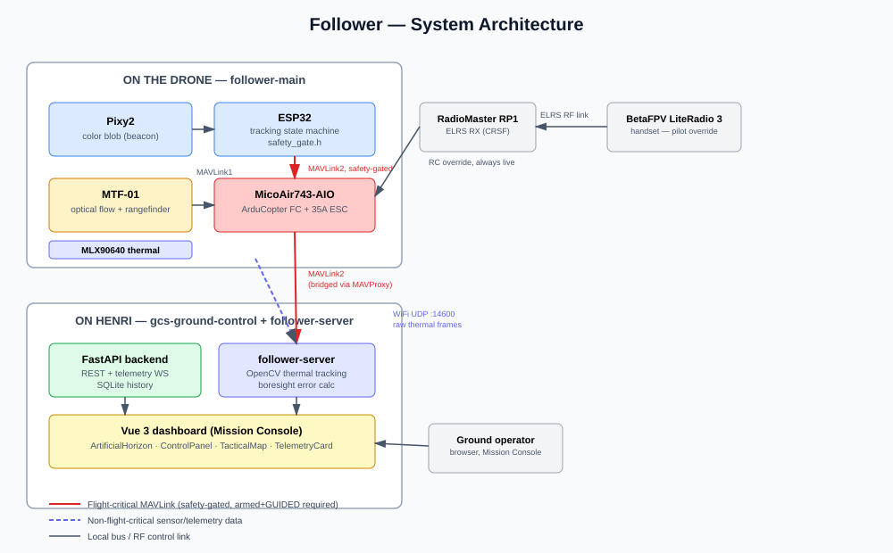

# follower-main


The flight stack. ESP32 companion firmware that tracks a subject via
Pixy2 and commands a MicoAir743-AIO flight controller running
ArduCopter — plus the parameter set, safety logic, and operations docs
that make that safe to actually fly.



Two companion repos complete the system: the ground station dashboard
lives in [gcs-ground-control](https://github.com/ptfoncloud/gcs-ground-control);
the thermal-tracking service that runs on Henri lives in
[follower-server](https://github.com/ptfoncloud/follower-server).

## Hardware

| Component | Part |
|---|---|
| Flight controller | MicoAir743-AIO (STM32H743, integrated 35A 4-in-1 ESC) |
| Companion computer | ESP32 dev board |
| Vision | Pixy2 (CMUcam5), SPI |
| Position/altitude (indoor) | MicoAir MTF-01 optical flow + rangefinder |
| Thermal (secondary tracking) | Adafruit MLX90640, 55° FOV |
| RC receiver | RadioMaster RP1 (ExpressLRS, CRSF) |
| RC transmitter | BetaFPV LiteRadio 3 |
| Firmware | ArduCopter (ArduPilot 4.6.0+) |

## The one thing worth understanding before anything else

Every velocity command the ESP32 sends passes through a single
function — `evaluate_safety_gate()` in `src/safety_gate.h` — that
refuses to command unless the FC is armed, in GUIDED mode, and its
heartbeat is recent. This isn't a claim: it's compiled and tested
standalone, independent of any ESP32 hardware:

```bash
g++ -std=c++17 -Wall -Wextra -Werror -o test_safety_gate test/native/test_safety_gate.cpp
./test_safety_gate
# ALL 13 CHECKS PASSED
```

`main.cpp` includes and calls this exact function — the tests aren't
exercising a parallel reimplementation that could quietly drift out of
sync with the real flight code.

## Repo layout

```
.
├── src/
│   ├── main.cpp           # ESP32 firmware
│   ├── safety_gate.h      # the gating logic — tested standalone
│   └── config.h           # tuning constants
├── test/native/
│   └── test_safety_gate.cpp
├── params/
│   └── follower.param     # full ArduCopter parameter set
├── esp32_thermal/
│   ├── thermal_stream.h   # MLX90640 -> WiFi UDP -> follower-server
│   └── thermal_wire.h     # 776-byte quantized frame format (tested)
├── scripts/
│   ├── launch_mavproxy.sh
│   └── launch_mavproxy.ps1
├── docs/
│   ├── OPERATIONS.md            # preflight checklist, abort procedure
│   ├── ENGINEERING_DECISIONS.md # why, not just what
│   ├── beacon_training.md       # Pixy2 signature training walkthrough
│   └── assets/architecture.svg
└── .github/workflows/build.yml  # firmware build + safety-gate tests, separately
```

## Setup, in order

1. **Read `params/follower.param`** and its comments before loading it
   into the FC. Two values need physical measurement, not a default:
   `FLOW_POS_X/Y/Z` (MTF-01 offset from CG) and `SERIAL4_BAUD` (verify
   against your actual MTF-01 unit).
2. **Train the beacon** — `docs/beacon_training.md`, on the bench,
   before anything flies.
3. **Set `PRIMARY_SIG`** in `src/config.h`, then `pio run -e esp32dev
   --target upload`.
4. **Read `docs/OPERATIONS.md`** — the actual preflight checklist and
   abort procedure, not just code comments.
5. Bench test props-off, then fly.

## Known gaps

- No telemetry radio in the current BOM — real-time link to Henri is
  USB-tethered only right now (`scripts/launch_mavproxy.sh usb`).
  Wireless range needs a telemetry radio or a WiFi relay on the ESP32
  (not built — would compete with Pixy2/thermal streaming for the same
  chip, needs its own bench-tested timing pass first).
- No compass — see `docs/ENGINEERING_DECISIONS.md` for the real
  consequence (yaw drift) and why it's disabled rather than
  half-configured.
- Gesture control via Leap Motion — architecture is settled (browser
  LeapJS → backend classifier → same command endpoints the dashboard
  uses), implementation not started.

## License

MIT — see [LICENSE](LICENSE).
